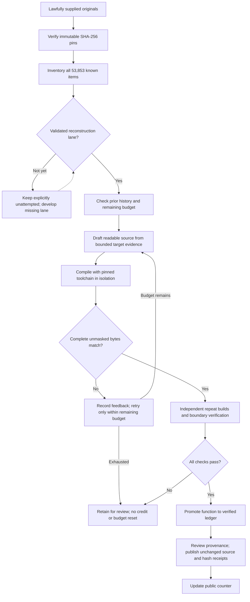

# NWN2 matching rebuild

<!-- BEGIN daily research progress -->
## **4,826 / 53,901 — VERIFIED RESEARCH PROGRESS**

**66,833 exact instruction bytes · Whole-file identity: 0 / 6**

Daily snapshot: **2026-11-26**, synchronized with the
[website and RSS](https://nwn2reassembled.fyi/#reconstruction) at 00:00 UTC.
These are research totals, not a rebuilt-game release or file-byte percentage.
The reviewed source release below contains **4,826
functions** (source snapshot: 2026-11-26).
Browse the [function sources and verification records](src/matched/index.json).
[Machine-readable progress](docs/research-progress.json).
<!-- END daily research progress -->

<!-- BEGIN published source -->
## **4,826 / 53,901 — VERIFIED & PUBLISHED**

**Complete, unmasked function matches · 66,833 instruction bytes · Whole-file identity: 0 / 6**

Source snapshot: **2026-11-26**. All **4,826 verified functions**
are indexed in **4,824 unchanged C/C++ source files**.
Browse the [binary/RVA-to-source index](src/matched/index.json),
[rules-library source](src/ruleslib/matched), [server source](src/server/matched),
and [client source](src/client/matched). Each function links to a hash-only verification record.

These are independent instruction-informed reconstruction probes, not a linked game,
source port or playable release. Names/types are hypotheses. No complete artifact
is claimed to match. See [provenance and licensing limits](PROVENANCE.md).
Daily updates include reviewed sources and receipts from the same frozen ledger
as the [website](https://nwn2reassembled.fyi/#reconstruction), once every 24 hours.
Unknown source/evidence forms stop publication for manual review; counters must
not silently advance without their corresponding sources.
<!-- END published source -->

## How reconstruction works



Every attempt or operational failure is recorded and synchronized additively to
the shared research knowledge base, with verified readback before another attempt.
Drafting is idle-only; compiler, ledger and knowledge-base writes are serialized.
Native leaves are the active bulk lane. General-native dependencies, managed
methods and resources need additional validated execution paths; an inventory or
diagram does not make those lanes complete. Function credit is **not** a linked
image-region match or whole-file identity. Publication summarizes recorded
verification; it does not claim a fresh compilation at publication time.

## Included

- Strict, unnormalized byte comparison and read-only PE inspection.
- Conventional i386 COFF function extraction with explicit boundary evidence
  and rejection of unresolved overlapping relocations.
- Three exploratory C implementations reconstructed from instruction-level
  analysis. They contain no embedded original instruction bytes. These particular
   C files are not a claim of pinned-compiler exactness or complete-game behavior.
- Unchanged matching C/C++ source files with per-function hash-only
  verification records. These are independent compilation probes, not a combined
  DLL build; names/types are hypotheses. See the [source guide](src/ruleslib/matched/README.md).
- OpenAI, Anthropic and DeepSeek drafting adapters, plus a source-and-hashes-only
  contribution exporter and a one-task Compose workflow.
- Synthetic tests and hash/size-only reference pins; no original game files.
- Offline evidence-gated native-unit manifests, original-site relocation
  materialization, unmasked region/alias/EH comparison, context packets,
  regression planning, persistent no-reset budget journals and union-byte
  accounting. See [the native-unit guide](docs/NATIVE_UNIT_PIPELINE.md).
  These tools do not compile, dispatch, promote or grant new matching credit.

## Local checks

Use Python 3.10 or newer. Install `requirements.txt` in your own environment:

```sh
python3 -m pip install -r requirements.txt
python3 -m unittest discover -s tests
python3 -m unittest discover -s contributor-worker/tests
```

Supply your own lawfully obtained reference files. Set `NWN2_REFERENCE_ROOT` to
their directory or pass `--references` explicitly. The default is the ignored
`private/references/` directory. Verify pins without changing your files:

```sh
python3 tools/matching.py verify --references private/references
```

Inventory/extraction commands can write proprietary data or local paths to their
outputs. Keep those outputs private; never commit or attach them to issues or PRs.
Tests use synthetic fixtures and need no game, compiler, provider key or network.

## Exactness and contributions

Successful compilation, behavioral equivalence, function equality, image-region
equality and full-file identity are different results. Only complete unmasked
stored-byte equality within justified boundaries earns the corresponding claim.
Do not add overlapping ranges or count historical matches twice.

Contributor receipts are untrusted claims requiring project-side rebuild and
verification. The exporter does not establish that its input receipts are true.
Source filters are not a compiler sandbox or an exhaustive secret detector.
Never execute untrusted source/scripts with credentials, writable original files
or privileged CI permissions. No automatic PR-submission or privileged CI workflow
is included. Provider calls incur charges and require an explicit model and a
process-environment API key; tests mock all provider requests.

The contributor Wine lane uses only user-supplied, hash-pinned toolchain files
mounted at runtime. Compiler files, game files, proprietary headers/libraries,
assets, assembly dumps and private operational records are not distributed.

## Contributor startup

Supply a supported classic GOG offline installer and the pinned compiler SDK ISO,
copy `.env.example` to `.env`, select a provider/model and enter its key, confirm
input licenses and provider-disassembly consent, then run:

```sh
docker compose up --build
```

The Visual C++ Redistributable alone is insufficient: the compiler is required.
See [the startup guide](docs/CONTRIBUTOR_STARTUP.md) for exact inputs, one-request
budget, isolation, result collection and known validation limits. It does not
install host packages, run the game, or automatically push to GitHub.
See [validation results and limitations](docs/VALIDATION.md) before treating this
as a fully validated installer-to-contribution path; GOG-installer extraction and
live paid-provider end-to-end validation remain outstanding.

## Contact

Contact the project maintainer at [nwn2reassembled@proton.me](mailto:nwn2reassembled@proton.me).

## License and provenance

Project-authored code is offered under MIT; see `LICENSE` and `PROVENANCE.md`.
This license grants no rights to the original game, compiler, trademarks or other
third-party material, and is not a legal opinion about reverse engineering.
